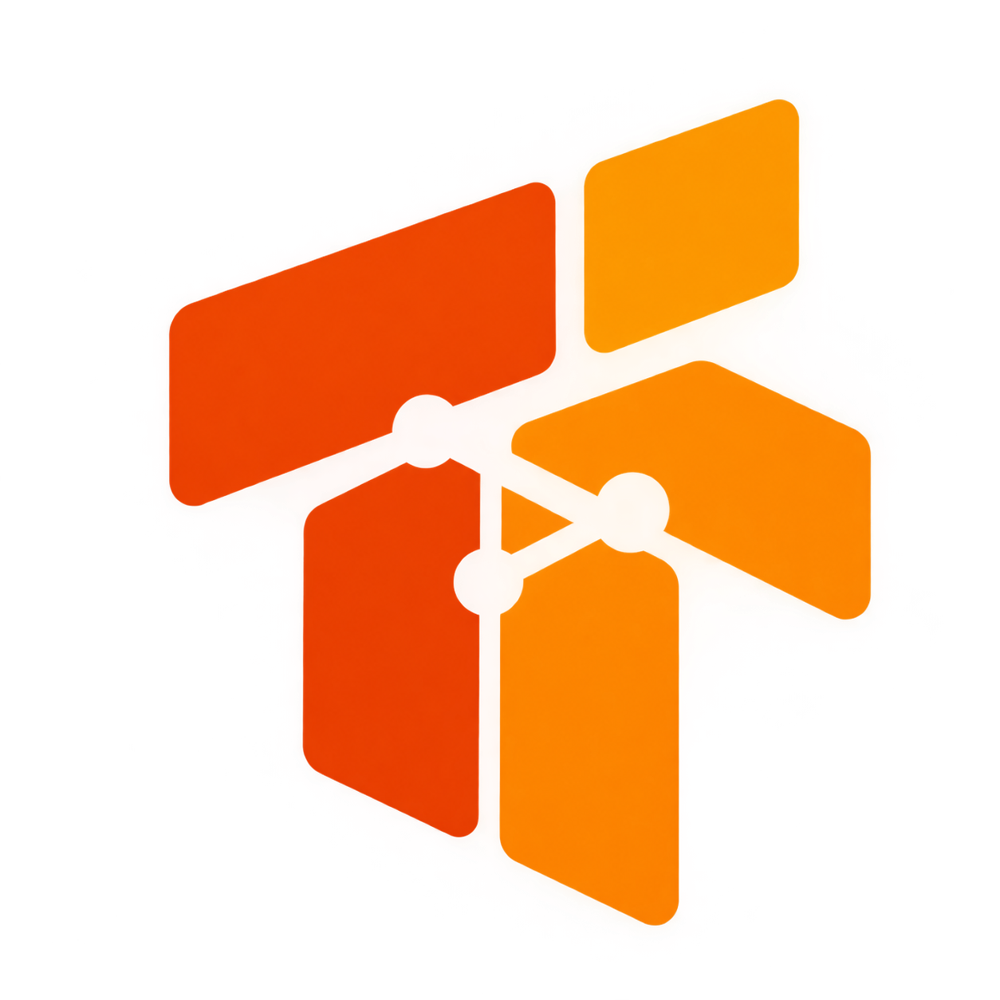
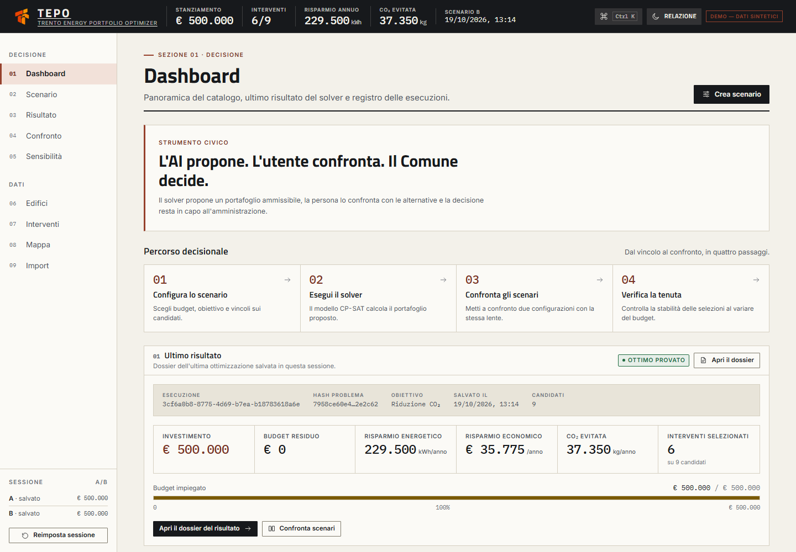
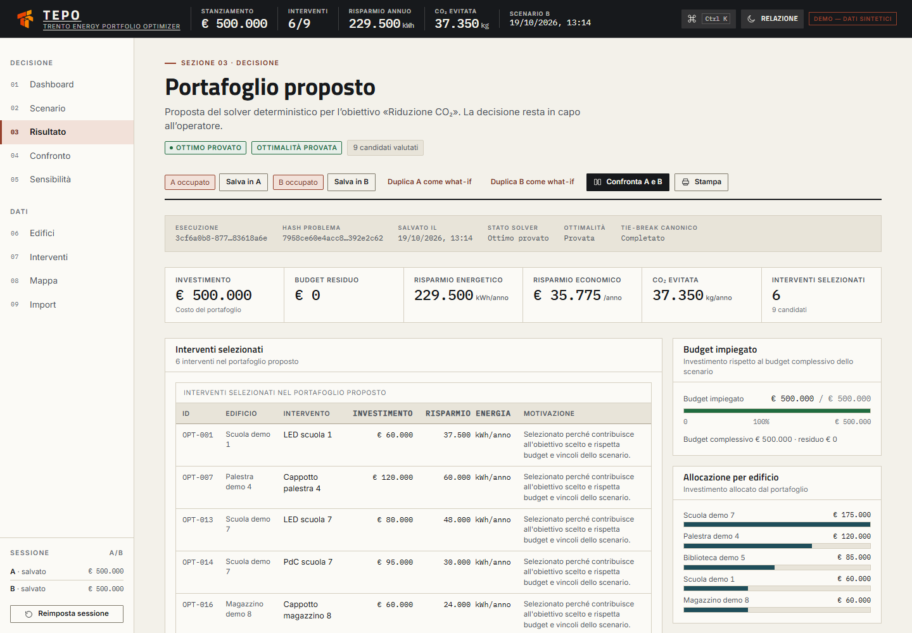
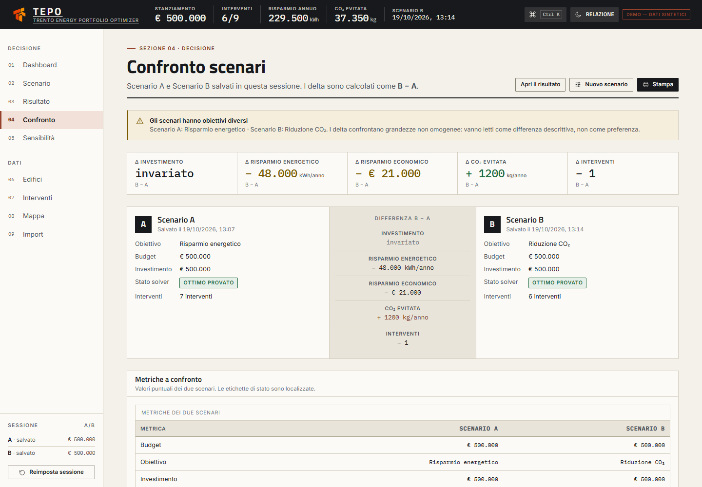
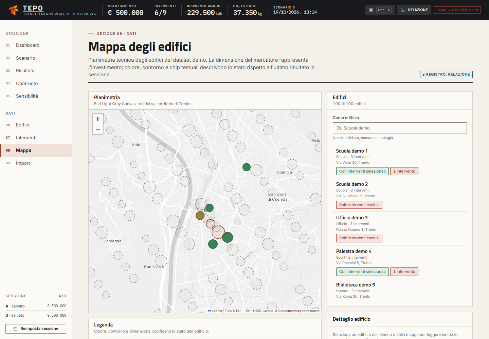
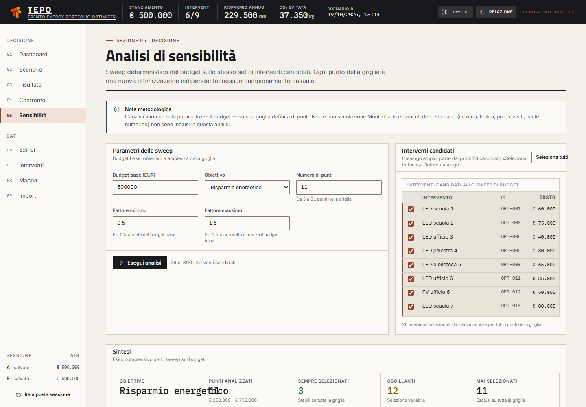

<div align="center">

  

  # Trento Energy Portfolio Optimizer (TEPO)

  **Decision Support System per la pianificazione e l'ottimizzazione degli interventi di efficientamento energetico sul patrimonio edilizio del Comune di Trento.**

  *Sviluppato nell'ambito dell'insegnamento di Ingegneria del Software (A.A. 2026/2027) — Università degli Studi di Trento (DISI)*  
  *Iniziativa istituzionale: « 100 progetti per il Comune di Trento »*

  <br />

  [](https://tepo.onrender.com)
  [](https://www.oracle.com/java/)
  [](https://spring.io/projects/spring-boot)
  [](https://developers.google.com/optimization)
  [](https://www.postgresql.org/)
  [](https://react.dev/)
  [](https://www.typescriptlang.org/)
  [](https://www.docker.com/)

  <br />

  [🌐 **Prova la Demo Live**](https://tepo.onrender.com) • [💻 **Repository del Codice (TEPO)**](https://github.com/T-E-P-O/TEPO) • [📑 **Deliverable D1 (Requirements)**](https://github.com/T-E-P-O/D1) • [🧪 **Sandbox Bozza (tepobozza)**](https://github.com/T-E-P-O/tepobozza)

</div>

---

## 🏛️ Visione e Principio Architetturale

La transizione ecologica e la riqualificazione energetica del patrimonio immobiliare pubblico pongono agli uffici tecnici comunali una sfida complessa: dato un insieme eterogeneo di edifici (scuole, uffici, impianti sportivi, sedi municipali), un catalogo di centinaia di opzioni di intervento (LED, infissi, isolamento termico a cappotto, pompe di calore, impianti fotovoltaici) e un budget di investimento limitato, **quale combinazione di interventi massimizza il beneficio per la collettività, nel rispetto rigoroso dei vincoli tecnici e di bilancio?**

**TEPO** è la risposta metodologica e ingegneristica a questo problema combinatorio di Knapsack/MILP binario.

> ### 💡 Il Principio Guida
> **« L'AI propone. L'utente confronta. Il Comune decide. »**
> 
> *L'assistenza intelligente velocizza l'impostazione degli scenari ma non ha accesso in scrittura ai dati né ai modelli matematici. Il motore deterministico calcola il portafoglio ottimale certificato con garanzia di riproducibilità. La decisione finale resta sempre saldamente nelle mani dei funzionari e degli amministratori pubblici.*

---

## 📸 Galleria dell'Applicazione ("Strumento Civico")

L'interfaccia utente è fondata sul design system editoriale **"Strumento Civico"**, dotato di doppio registro di lettura ad alta leggibilità: **Relazione** (ottimizzato per schermi luminosi, proiezioni e stampa formale) e **Sala operativa** (registro scuro ad alto contrasto per lunghe sessioni analitiche).

| **Dashboard Operativa (Registro Relazione)** | **Dossier di Risultato & Audit Strip** |
|:---:|:---:|
|  |  |
| *Fascia di stato permanente, indicatori KPI e percorso decisionale.* | *Hash canonico, motivazioni deterministiche e allocazione per edificio.* |

| **Confronto Scenari What-If (A vs B)** | **Mappa Geografica degli Edifici** |
|:---:|:---:|
|  |  |
| *Scostamenti differenziali diretti (B − A) e matrici di confronto.* | *Cartografia interattiva Leaflet con marcatura proporzionale all'investimento.* |

<div align="center">
  
  <p><em>Analisi di sensibilità deterministica: sweep sul budget da 3 a 51 punti per identificare interventi stabili e oscillanti.</em></p>
</div>

---

## 🗂️ Mappa delle Repository dell'Organizzazione

L'organizzazione GitHub **[T-E-P-O](https://github.com/T-E-P-O)** è strutturata secondo una rigida divisione delle responsabilità tra codice applicativo e deliverable accademici:

| Repository | Descrizione | Stato |
|:---|:---|:---:|
| **[TEPO/TEPO](https://github.com/T-E-P-O/TEPO)** | **Repository Principale del Software.** Contiene l'intero codice sorgente (Spring Boot 3, OR-Tools, React/TS), suite di test automatizzati (119 test backend, 69 frontend), blueprint Docker e configurazione Render IaC. | 🟢 Attivo |
| **[TEPO/D1](https://github.com/T-E-P-O/D1)** | **Deliverable D1 — Requirements Engineering.** Documento formale in LaTeX (64 pagine) sincronizzato con Overleaf, contenente la specifica formale dei requisiti (RF/RNF), Use Cases, User Stories INVEST, Wireframe Canva e Matrice di Tracciabilità completa. | 🟢 Rilasciato |
| **[TEPO/tepobozza](https://github.com/T-E-P-O/tepobozza)** | **Repository Sandbox e Integrazione.** Versione con tutti i 10 feature branch didattici già mergiati e sincronizzati sul branch `main`. | 🟢 Sincronizzato |
| **[TEPO/D2](https://github.com/T-E-P-O/D2)** | **Deliverable D2 — Architectural Design & Testing.** Specifica architetturale, protocollo di collaudo e verifica sul campo. | 🟡 In sviluppo |
| **[TEPO/D3](https://github.com/T-E-P-O/D3)** | **Deliverable D3 — Quality Assurance & Test Report.** Analisi statica, metriche di copertura e benchmark prestazionali. | ⚪ Pianificato |
| **[TEPO/D4](https://github.com/T-E-P-O/D4)** | **Deliverable D4 — Final Handover & User Manuals.** Manuale operativo per l'ufficio tecnico del Comune e documentazione di chiusura. | ⚪ Pianificato |

---

## ⚙️ Caratteristiche Funzionali Distintive

### 1. 🧮 Motore di Ottimizzazione OR-Tools CP-SAT
- Risoluzione esatta del problema combinatorio con formulazione MILP binaria.
- Supporto a vincoli di bilancio, incompatibilità mutua simmetrica ($x_A + x_B \le 1$), prerequisiti logici ($x_A \implies x_{\text{req}}$), quote massime di selezione e inclusioni/esclusioni forzate.
- **Tie-break canonico a 4 passi:** (1) Massimizzazione obiettivo primario $\implies$ (2) Minimizzazione investimento totale $\implies$ (3) Minimizzazione numero di cantieri $\implies$ (4) Ordinamento lessicografico stabile per ID.
- Hash crittografico canonico dello scenario per garantire auditabilità assoluta e riproducibilità matematica.

### 2. 🔍 Modulo Spiegazioni Deterministiche ("Reason Codes")
Ogni singolo intervento candidato riceve una spiegazione verificabile e locale:
- *Selezionato per contributo all'obiettivo*;
- *Selezionato in quanto prerequisito*;
- *Escluso per incompatibilità con intervento scelto*;
- *Escluso per prerequisito mancante*;
- *Escluso per superamento budget residuo o complessivo*;
- *Escluso in quanto non ottimale (causa locale non deducibile)*.

### 3. ⚖️ Confronto Scenari What-If (Slot A/B)
- Salvataggio rapido in sessione di due configurazioni alternative.
- Analisi automatica degli scostamenti $\Delta = B - A$ su kWh risparmiati, spesa annua ridotta, tonnellate di CO$_2$ e cantieri avviati.
- Tabella differenziale degli interventi aggiunti e rimossi tra gli scenari.

### 4. 📈 Sweep Deterministico di Sensibilità
- Variazione sistematica del budget base su griglie da 3 a 51 campioni.
- Classificazione dei candidati in:
  - **Sempre selezionati** (*core investments* stabili e prioritari);
  - **Mai selezionati** (*non convenienti* nel range esplorato);
  - **Oscillanti** (*swing options*, dipendenti dalla specifica disponibilità di bilancio).

### 5. 🤖 Assistente AI Confinato (Human-in-the-Loop)
- Interpreta richieste in linguaggio naturale (es. *"Voglio massimizzare la riduzione di CO2 con 750.000 euro concentrandomi sulle scuole"*).
- Propone una configurazione di scenario precompilata.
- Fallback locale a regole in assenza di credenziali esterne (nessuna API key obbligatoria).
- **Controllo Umano Obbligatorio:** nessuna proposta viene applicata automaticamente senza approvazione esplicita dell'operatore.

---

## 🛠️ Stack Tecnologico e Giustificazione Didattica

L'architettura software è stata progettata privilegiando affidabilità e rigore matematico:

| Componente | Scelta Tecnologica | Motivazione Tecnica di Trade-off |
|:---|:---|:---|
| **Ottimizzazione & Backend** | **Java 21 + Spring Boot 3 + Google OR-Tools CP-SAT** | OR-Tools offre binding industriali nativi e stabili per CP-SAT con vincoli logici avanzati (`OnlyEnforceIf`). Node.js non dispone di solutori MILP binari equivalenti maturi per l'ottimizzazione combinatoria esatta. |
| **Database & Integrità** | **PostgreSQL 16 + Flyway Migrations** | Dominio fortemente relazionale caratterizzato da vincoli di chiave esterna e integrità referenziale (edifici $\leftrightarrow$ interventi $\leftrightarrow$ incompatibilità). Un database NoSQL come MongoDB esporrebbe a disallineamenti e stati orfani. |
| **Frontend & UI** | **React 18 + TypeScript + Vite + Leaflet** | Strutture dati complesse (matrici di scostamento, coordinate territoriali, vettori di sensibilità). TypeScript garantisce tipizzazione statica a tempo di compilazione ed elimina errori di runtime. |
| **Infrastruttura & Deploy** | **Docker Compose + Cloud Render (onrender.com)** | Containerizzazione completa per sviluppo locale multi-piattaforma (x86_64 e ARM64) e deployment immediato su Render con monitoraggio e porte dinamiche. |

---

## 🚀 Quickstart: Avvio in Locale

### Avvio Rapido con Docker Compose (Raccomandato)

Requisiti: **Docker Desktop** installato e avviato.

```bash
# 1. Clona la repository principale
git clone https://github.com/T-E-P-O/TEPO.git
cd TEPO

# 2. Avvia l'intero stack (DB PostgreSQL + Backend Spring Boot + Frontend React)
docker compose up --build
```

Una volta terminato il build:
- 🌐 **Frontend Web:** [http://localhost:5173](http://localhost:5173)
- 🔌 **API REST Swagger UI:** [http://localhost:8080/swagger-ui.html](http://localhost:8080/swagger-ui.html)
- 🐘 **Database PostgreSQL:** `localhost:5432` (db: `tepo`, user: `tepo`, pass: `tepo`)

### Esecuzione della Suite di Test

```powershell
# Esecuzione 119 test backend (tramite container Docker isolato)
.\scripts\test-backend.ps1

# Esecuzione 69 test frontend (Vitest)
cd frontend
npm test
```

---

## 👥 Team di Sviluppo — Gruppo T14

Progetto sviluppato congiuntamente da:

- **Mirco Negri** — [@mirconegri](https://github.com/mirconegri)
- **Gabriele Duca** — [@ghebbb](https://github.com/ghebbb)
- **Riccardo Scheda** — [@scheddiee](https://github.com/scheddiee)

---

<div align="center">
  <sub>Università degli Studi di Trento — Dipartimento di Ingegneria e Scienza dell'Informazione (DISI)</sub><br />
  <sub>Corso di Ingegneria del Software (A.A. 2026/2027) — Progetto TEPO</sub>
</div>
